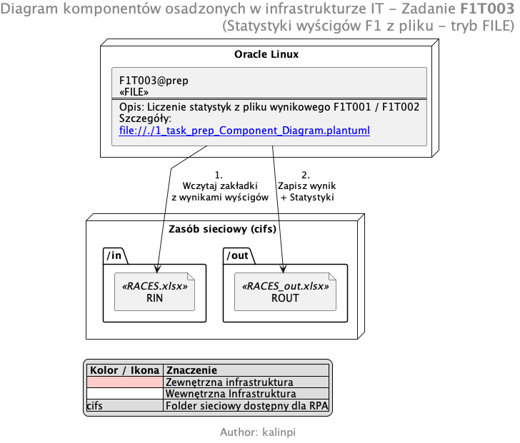
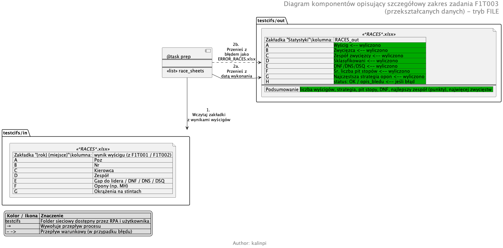

## Dokumentacja opisująca zakres prac Robota F1T003

### Zadania (taski) robota

Robot składa się z dwóch zadań uruchamianych niezależnie (`F1T003.sh <zadanie>`):

| Zadanie | Opis |
|---|---|
| `prep` | Główne zadanie robota: wczytuje plik wynikowy F1T001 / F1T002 (`*RACES*.xlsx`) z katalogu `in/`, liczy statystyki wyścigów, dopisuje zakładkę `Statystyki` i przenosi plik do katalogu `out/`. Działa bez internetu. |
| `Dolog` | Zbiera logi `.json` z kolejnych uruchomień do pliku Excel ze statystykami pracy robota. |

Zapis `F1T003@prep` na diagramach oznacza: robot F1T003, zadanie `prep`.

### Opis diagramów

- Diagramy opisujące, jak komponenty komunikują się ze sobą (i w jakiej kolejności).
    - Uproszczony zakres F1T003 na infrastrukturze
    

    - Zadanie prepare

        Liczenie statystyk (zwycięzca, DNF, pit stopy, strategie opon, najlepszy zespół) z zakładek z wynikami wyścigów – zakres realizowany w F1T003@prep
        

    - [4_dolog_DiagramSekwencji](./4_dolog_SequenceDiagram.plantuml) główne sekwencje w dolog.py do zbierania statystyk do Excela.

#### Podgląd i edycja diagramów
Obrazki `.png` powyżej są wygenerowane z plików `.plantuml`. Po zmianie diagramu trzeba wygenerować je ponownie: `java -jar plantuml.jar -tpng <plik>.plantuml`.

Podgląd plików `.plantuml`:
- w edytorze: zainstaluj wtyczkę PlantUML (np. [VS Code](https://marketplace.visualstudio.com/items?itemName=jebbs.plantuml), [IntelliJ IDEA / PyCharm](https://plugins.jetbrains.com/plugin/7017-plantuml4idea)) oraz Javę i Graphviz zgodnie z opisem wtyczki,
- bez instalacji: wklej treść diagramu na stronie https://www.plantuml.com/plantuml/uml.
