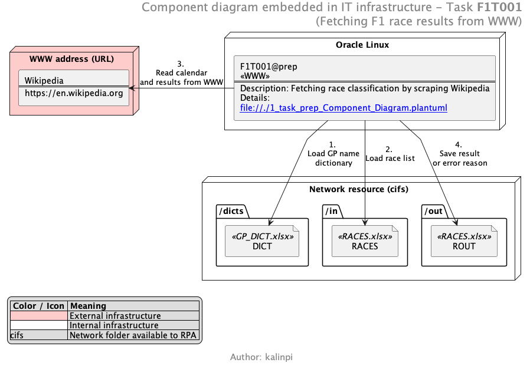
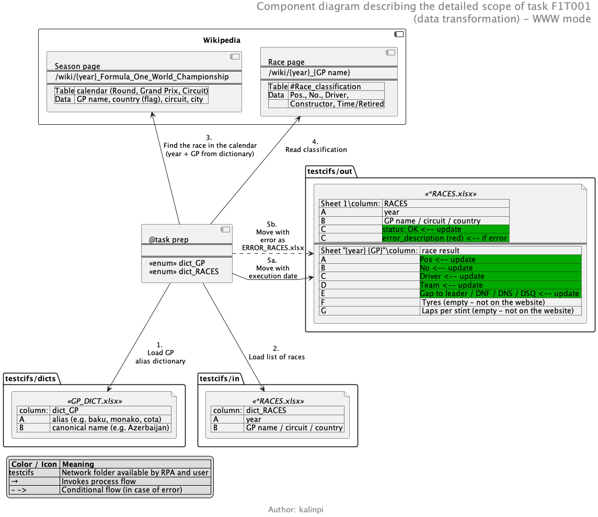

## Documentation describing the Robot F1T001 scope of work

### Robot tasks

The robot consists of two tasks run independently (`F1T001.sh <task>`):

| Task | Description |
|---|---|
| `prep` | Main robot task: reads `*RACES*.xlsx` from the `in/` folder, fetches data from the website (Wikipedia), writes the status to column C and adds one sheet per race, then moves the file to `out/` (with the date or the `ERROR_` prefix). |
| `Dolog` | Collects `.json` logs from consecutive runs into an Excel file with robot work statistics. |

The notation `F1T001@prep` on the diagrams means: robot F1T001, task `prep`.

### Diagrams Description

- Diagrams describing how components communicate with each other (and in what order).
    - Simplified scope of F1T001 on infrastructure
    

    - Prepare task

        Fetching F1 race results (classification, drivers, teams) from the website (Wikipedia) for the races listed in RACES.xlsx – scope implemented in F1T001@prep
        

    - [4_dolog_SequenceDiagram](./4_dolog_SequenceDiagram.plantuml) main sequences in dolog.py for collecting statistics into Excel.

#### Viewing and editing the diagrams
The `.png` images above are generated from the `.plantuml` files. After changing a diagram, generate them again: `java -jar plantuml.jar -tpng <file>.plantuml`.

To preview `.plantuml` files:
- in an editor: install a PlantUML plugin (e.g. [VS Code](https://marketplace.visualstudio.com/items?itemName=jebbs.plantuml), [IntelliJ IDEA / PyCharm](https://plugins.jetbrains.com/plugin/7017-plantuml4idea)) and Java and Graphviz as described by the plugin,
- without installing anything: paste the diagram content on https://www.plantuml.com/plantuml/uml.
