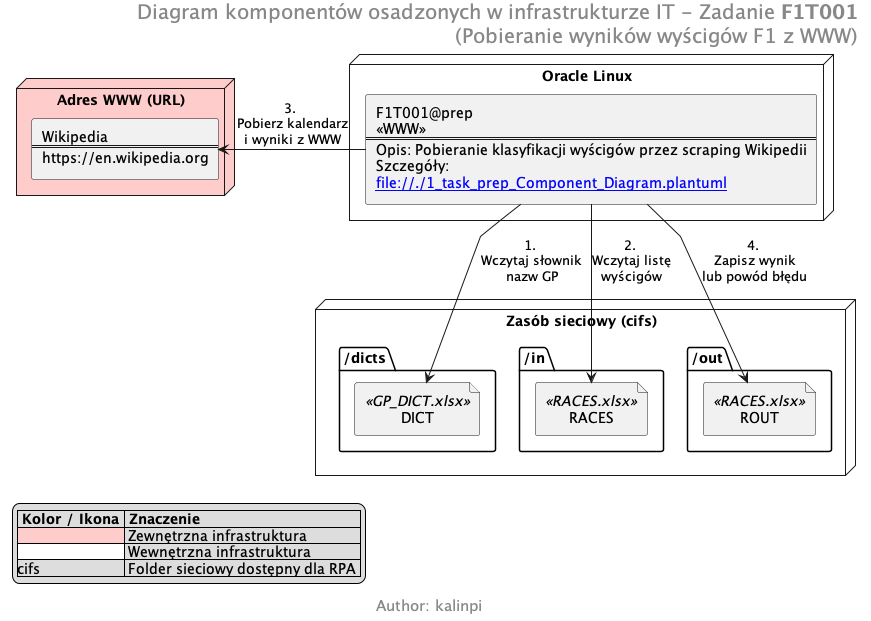
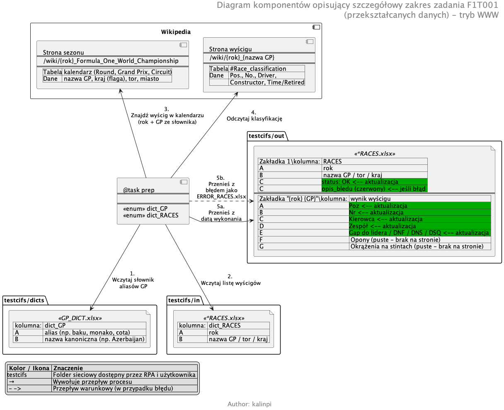

## Dokumentacja opisująca zakres prac Robota F1T001

### Zadania (taski) robota

Robot składa się z dwóch zadań uruchamianych niezależnie (`F1T001.sh <zadanie>`):

| Zadanie | Opis |
|---|---|
| `prep` | Główne zadanie robota: wczytuje `*RACES*.xlsx` z katalogu `in/`, pobiera dane ze strony WWW (Wikipedia), dopisuje status w kolumnie C i zakładkę dla każdego wyścigu, po czym przenosi plik do `out/` (z datą lub prefiksem `ERROR_`). |
| `Dolog` | Zbiera logi `.json` z kolejnych uruchomień do pliku Excel ze statystykami pracy robota. |

Zapis `F1T001@prep` na diagramach oznacza: robot F1T001, zadanie `prep`.

### Opis diagramów

- Diagramy opisujące, jak komponenty komunikują się ze sobą (i w jakiej kolejności).
    - Uproszczony zakres F1T001 na infrastrukturze
    

    - Zadanie prepare

        Pobieranie wyników wyścigów F1 (klasyfikacja, kierowcy, zespoły) ze strony WWW (Wikipedia) dla wyścigów podanych w pliku RACES.xlsx – zakres realizowany w F1T001@prep
        

    - [4_dolog_DiagramSekwencji](./4_dolog_SequenceDiagram.plantuml) główne sekwencje w dolog.py do zbierania statystyk do Excela.

#### Podgląd i edycja diagramów
Obrazki `.png` powyżej są wygenerowane z plików `.plantuml`. Po zmianie diagramu trzeba wygenerować je ponownie: `java -jar plantuml.jar -tpng <plik>.plantuml`.

Podgląd plików `.plantuml`:
- w edytorze: zainstaluj wtyczkę PlantUML (np. [VS Code](https://marketplace.visualstudio.com/items?itemName=jebbs.plantuml), [IntelliJ IDEA / PyCharm](https://plugins.jetbrains.com/plugin/7017-plantuml4idea)) oraz Javę i Graphviz zgodnie z opisem wtyczki,
- bez instalacji: wklej treść diagramu na stronie https://www.plantuml.com/plantuml/uml.
